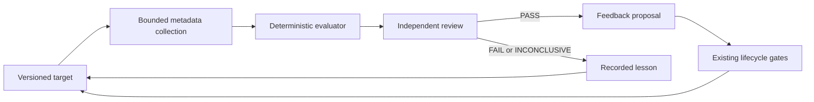

# AGENTS.md: SKRSI for agents and new users

This file is the single source of agent instructions for this repository, and the fastest complete introduction to
SKRSI for a new user. It works with any agent framework (Claude Code, Codex, Cursor, Gemini CLI, Aider, OpenCode,
Hermes, Pi, a custom loop) and any stack (Python, Rust, Go, TypeScript, JVM, shell, infrastructure code). Nothing in
it assumes a particular model, host, board or forge beyond what each section says it needs.

If you only read one section, read [2. Rules every agent follows](#2-rules-every-agent-follows).

## Contents

1. [What SKRSI is](#1-what-skrsi-is)
2. [Rules every agent follows](#2-rules-every-agent-follows)
3. [How the framework fits together](#3-how-the-framework-fits-together)
4. [Repository map](#4-repository-map)
5. [The contracts](#5-the-contracts)
6. [Adopt SKRSI in your project (any stack)](#6-adopt-skrsi-in-your-project-any-stack)
7. [Outcome rules: how a verdict is decided](#7-outcome-rules-how-a-verdict-is-decided)
8. [Live evidence: measuring where the data is](#8-live-evidence-measuring-where-the-data-is)
9. [Instances: one private config repo per cluster](#9-instances-one-private-config-repo-per-cluster)
10. [Lessons and the tag vocabulary](#10-lessons-and-the-tag-vocabulary)
11. [Baselines and build-quality telemetry](#11-baselines-and-build-quality-telemetry)
12. [The lane playbook: orchestrator, worker, reviewer](#12-the-lane-playbook-orchestrator-worker-reviewer)
13. [Working on this repository](#13-working-on-this-repository)
14. [Using this file from any agent framework](#14-using-this-file-from-any-agent-framework)
15. [Troubleshooting](#15-troubleshooting)
16. [Glossary](#16-glossary)

---

## 1. What SKRSI is

**SKRSI** means **SK Recursive SELF Improvement**, where SELF is **Systematic Evaluation, Learning, and Feedback**.
The canonical long form is *SK Recursive Systematic Evaluation, Learning, and Feedback Improvement*. Use it exactly;
do not invent another expansion.

SKRSI is an evidence-first improvement loop for software delivery. It answers one question honestly: *did this
change make things better, by the measure we declared before we made it?*

- **Systematic:** declare targets, cohorts, metrics and stop rules before the change.
- **Evaluation:** compare a baseline and a treatment without inventing causality or hiding missing data.
- **Learning:** keep outcomes and lessons as versioned, attributable records.
- **Feedback:** route bounded proposals back to whoever already owns the decision.

What SKRSI **is**: portable JSON Schema contracts, stdlib-only Python scripts that build and validate records, a
reusable advisory CI workflow, instance templates, and a playbook for running agent work in lanes.

What SKRSI **is not**: an approver, a merge bot, a deployer, a scheduler, a policy engine, a dashboard or a data
store. It proposes. Existing owners and gates decide.

## 2. Rules every agent follows

These hold in this repository and in every project that adopts SKRSI. A change that breaks one is rejected in review.

### Authority

1. **Advisory only.** SKRSI never merges, deploys, releases, actuates, changes access, or becomes a required check.
   A valid SKRSI record grants no permission of any kind.
2. **Proposals, not decisions.** Models and agents produce typed proposals. Workflow state, authorization, merge,
   deploy and release stay with their existing owners.
3. **Distinct producer and reviewer.** Whoever produced a change never reviews or approves it. The evaluation
   contract encodes this as an ordered pair of different `participants`.
4. **Work from an explicit, claimed work item.** One task (card, issue, ticket) per change. Do not start, move,
   claim or close a work item you do not own.
5. **No new human gate** unless current authority cannot be established safely. Notify people of ordinary outcomes;
   do not make them wait on them.

### Evidence

6. **Missing is never zero.** A crashed, unreachable or unmeasured arm is `null` and becomes explicit missingness.
7. **Inconclusive stays inconclusive.** No model, agent or operator relabels it as a pass.
8. **Throughput never overrides quality, security, independence or rollback.** Faster is not better if a guardrail
   failed.
9. **Evidence is append-only.** Never rewrite a historical record, even to update terminology. Write a new record
   and link it.
10. **Rules come from the base side.** A change cannot relax the bar it is measured against.

### Hot path

11. **No synchronous additions.** Nothing is added to a request, a task claim, a dispatch, a completion, a search or
    a session start. SKRSI reads what those paths already write.
12. **One extra field, never one extra call.** At most one field may be added to an existing write.
13. **Collection runs out of band,** on a timer or in CI. A stopped collector changes nothing for any workflow.
14. **Bounded everything.** Queues, retries, timeouts, concurrency and evidence size all have limits.
15. **Each loop must cost less than it saves.** Its own token and time cost is one of its metrics. A lesson or metric
    that moves nothing is retired.

### Data boundary

16. **Metadata only.** Never collect, commit or post prompts, model responses, message bodies, memory content, PR or
    review text, diffs, credentials, tokens, private host names, IP addresses, domains or personal paths.
17. **Hash opaque identifiers** when an aggregate does not need their clear value.
18. **Public repos stay scrubbed.** This repository, the instance template and every public example hold only
    synthetic names. `scripts/validate_public.py` and the scrub CI enforce a floor; review enforces the rest.

### Craft

19. **Test first.** Write the failing test, watch it fail, implement, watch it pass.
20. **Commit before the long verification.** Commit as soon as the targeted test passes, then run the full suite
    and amend. Never gate a commit on a background job: a turn can end mid-run and uncommitted work is lost.
21. **One worktree and one branch per change.** Never edit the default branch of a shared checkout.
22. **Verify, do not trust "done".** Check `git status --porcelain` and `git log origin/main..HEAD` before believing
    any report, including your own.
23. **Attribution is a factual claim.** A commit trailer names the agent that actually did the work, or nothing.
24. **Never touch live state from a test.** When an agent or profile is declared in the environment, a bare store
    constructor can open real data. Pass an explicit temporary backend.
25. **Scratch never lives in `/tmp`.** Use a state directory (`$XDG_STATE_HOME/...`). Clean up exact paths only,
    never a glob.
26. **Writing style.** Regular hyphens only. Never use an em dash or an en dash, in prose, code comments, commits or
    PR text. Keep lowercase `skrsi` for every runtime, schema, metric and evidence identifier.

## 3. How the framework fits together

SKRSI has four layers. Each one is optional to adopt, and each one reads what the layer before it already wrote.

| Layer | What it is | Where it lives |
|---|---|---|
| **Instrument** | A target file and a bench that emits a metrics JSON | `skrsi/` in each adopting repo |
| **Evidence** | Evaluation records built from two metrics files; daily aggregates from collectors | PR comments and artifacts, or a private instance repo |
| **Lessons** | One actionable rule per page, with evidence and the check that enforces it | The adopter's canon (a docs or knowledge repo) |
| **Feedback** | Proposals routed to existing owners, and small pre-rendered digests | The adopter's board and the briefs agents already read |

The loop:



The framework and instance split:

- **Framework** (this repo, public): schemas, validators, scripts, templates, docs. It knows *how* to measure.
- **Instance** (one private `skrsi-config-<cluster>` repo per cluster): that cluster's node names, baselines,
  evidence and evaluations. It pins an exact framework release.
- **Service repos**: target *definitions* and fixture-based evaluations. No cluster numbers.
- **Canon**: lessons.

Golden rule: if another operator on a different cluster would want the change, it belongs in the framework. If it
names a node, a measured number or a cluster threshold, it belongs in the instance. If both, split it.

Two delivery rules keep feedback cheap:

- **Lessons are delivered pre-rendered.** A worker or session gets a small static file. No model call and no
  database query happens at brief or session time.
- **Interactive sessions pull lessons on demand** (a tool call), they are not injected into every context.

## 4. Repository map

| Path | What it holds |
|---|---|
| `README.md` | Identity, scope, honest claims, docs index |
| `SOP.md` | Build, test, release, troubleshooting |
| `docs/ARCHITECTURE.md` | Start here for internals: the four diagrams, responsibilities, invariants |
| `docs/CONTRACTS.md` | The contract catalog and compatibility rules |
| `docs/ADOPTER-GUIDE.md` | Targets, benches, the caller workflow, metrics shape, outcome rules, signal tips |
| `docs/INSTANCE-MODEL.md` | Framework and instance repos, `cluster.yaml`, evidence publishing, what an instance may hold |
| `docs/PLAYBOOK-LANES.md` | Lane roles, the loop, review round records, every lesson with its check |
| `docs/CONFORMANCE.md` | Record, evidence and lifecycle conformance levels |
| `docs/MIGRATION-V2-V3.md` | The fail-closed evaluation v2 to v3 migration |
| `docs/CASE-STUDY-SKMEMORY-RETRIEVAL.md` | What the first adopter learned |
| `schemas/` | JSON Schema contracts and the lesson tag vocabulary |
| `examples/` | Synthetic golden records, reproduced by tests |
| `targets/sk-build-quality.json` | The target for build-quality telemetry |
| `scripts/build_evaluation.py` | Builds and validates `skrsi.evaluation.v4` (`validate_v4` is normative) |
| `scripts/evaluation_report.py` | Renders the PR comment |
| `scripts/build_telemetry.py` | Build-quality metrics from `gh` and board metadata |
| `scripts/baseline_*.py` | Freeze a measured baseline from a source, read-only |
| `scripts/validate_public.py` | Public-artifact scan and the normative lesson validator |
| `scripts/validate_instance.py`, `scripts/cluster_config.py` | Instance validation and the strict `cluster.yaml` loader |
| `scripts/generate-config-template.sh` | Writes the public instance template from `templates/instance-repo/` |
| `scripts/migrate_evaluation_v2_to_v3.py` | Deterministic record migration |
| `templates/worker-brief.md`, `templates/review-brief.md` | Briefs for lane workers and reviewers |
| `templates/land.sh`, `templates/merge.sh`, `templates/remote-test.sh` | The landing kit |
| `templates/instance-repo/` | The instance fixture (synthetic names only) |
| `.github/workflows/evaluate.yml` | The reusable, advisory PR evaluation workflow |
| `.github/workflows/docs.yml` | This repo's required check: tests, public scan, whitespace |

Every script is Python 3 standard library only. Tests need `jsonschema` (`requirements-dev.txt`). The workflow needs
GitHub Actions and `gh`; everything else runs anywhere Python 3 runs.

## 5. The contracts

Every record names its exact schema identifier. Consumers reject unknown versions and unknown properties.

| Contract | Identifier | Purpose |
|---|---|---|
| Target | `skrsi.target.v2` | The objective, metrics, invariants, stop rules, expiry and rollback owner, declared up front |
| Event envelope | `skrsi.event-envelope.v1` | Attributable metadata with lineage, hashes and a redaction class |
| Evaluation | `skrsi.evaluation.v4` | Baseline vs treatment, per-metric verdicts, guardrails, missingness, `evidence_class`, `instrument` |
| Feedback handoff | `skrsi.feedback-handoff.v1` | A proposal routed to an existing authority, granting nothing |
| Lesson | `skrsi.lesson.v1` | Front matter of a canon `lesson` page |
| Lesson tags | `skrsi.lesson-tags.v1` | The one tag vocabulary for lessons and review failure classes |
| Cluster | `skrsi.cluster.v1` | `cluster.yaml` of an instance repo |

Evaluation v2 and v3 stay immutable for history. New producers write v4.

Compatibility, in short (full text in `docs/CONTRACTS.md`):

- A published schema file and identifier never change. Any field or constraint change is a new identifier and file.
- Timestamps are RFC 3339 UTC. Digests are lowercase SHA-256 hex. Lesson dates are `YYYY-MM-DD`.
- Identifiers are opaque and never carry credentials, content, personal paths or private host names.
- The tag vocabulary is the one exception: append-only within v1, capped at 32 tags. Renaming or removing a tag
  needs `lesson-tags-v2`.
- JSON Schema cannot do arithmetic, so the Python validators (`validate_v4`, `lesson_errors`, `instance_errors`) are
  normative. The schemas and validators are tested against each other.

## 6. Adopt SKRSI in your project (any stack)

Adoption is three files and no new dependency in your project: a target, a bench that writes JSON, and one CI step.

### Step 1: declare a target

Create `skrsi/targets/<name>.json` before you make the change you want to measure. Start from
`examples/target-v2.json` or `examples/target-v2-agent-workflow-latency.json`.

- `objective`: one sentence on what better means.
- `metrics`: the metric names your bench will emit.
- `invariants`: statements your bench can assert as true or false. Only list what someone can actually assert.
- `stop_rules`: ids with a condition, an action and an owner. A metric's `stop_rule` must name one of them.
- `owner`, `status`, `revision`, `scope`, expiry and rollback owner as the schema requires.

Measurement coverage is a metric in its own right. A latency number measured on a tenth of the population is not a
small version of the truth.

### Step 2: make your bench write a metrics file

Your bench can be any program in any language: a pytest plugin, a `cargo bench` wrapper, a Go test, a k6 script, a
shell pipeline over logs. It only has to write this JSON shape to the path in `$SKRSI_METRICS_OUT`:

```json
{
  "cohort": {"id": "pr-head", "sample_size": 30, "window_start": "2026-01-01T00:00:00Z", "window_end": "2026-01-01T01:00:00Z"},
  "instrument": {"runs_production_code": true, "baselines_named": ["bm25_only"], "sabotage_tested": true, "dead_arms_reported": true},
  "invariants": {"<exact invariant text from the target>": true},
  "metrics": {
    "recall_at_5": {"value": 0.7, "unit": "ratio", "direction": "higher", "tolerance": 0.02, "noise": 0.016, "min": 0.5, "stop_rule": "recall-floor"}
  }
}
```

- `value: null` means dead or unmeasured. It becomes missingness, never zero.
- `direction` is `higher` or `lower`. `tolerance` is relative to the baseline. `min` and `max` are absolute bounds.
- `noise` is the instrument's run-to-run noise in the metric's unit. Measure it: run the bench twice or more on the
  same commit and data, and take the largest difference (or 2x the standard deviation over 3 or more runs). Never
  set it below 1/N for a bench of N items.
- Rules (`direction`, `tolerance`, `noise`, `min`, `max`, `stop_rule`, `unit`) and `instrument` are read from the
  **base** side. The PR side supplies values and invariants.

Be honest in `instrument`. `runs_production_code` means the measured arm is the real code path, not a
reimplementation. `sabotage_tested` means you broke production on purpose and watched the bench go red.

### Step 3a: GitHub Actions (one caller workflow)

```yaml
name: skrsi
on:
  pull_request:
    paths: ["src/**", "skrsi/**"]
jobs:
  evaluate:
    permissions: {contents: read, pull-requests: write}
    uses: smilinTux/skrsi/.github/workflows/evaluate.yml@skrsi-v1.1.0
    with:
      skrsi_ref: skrsi-v1.1.0
      target_file: skrsi/targets/my-target.json
      evidence_class: synthetic            # or live_self_retrieval, live_labelled
      setup_command: pip install -e .      # npm ci, cargo fetch, go mod download, anything
      bench_command: python -m my_pkg.bench --skrsi-out "$SKRSI_METRICS_OUT"
```

Inputs: `target_file`, `bench_command` and `evidence_class` are required. `baseline_command` (defaults to
`bench_command`), `setup_command`, `skrsi_ref` (default `main`) and `timeout_minutes` (default 15) are optional.

The workflow benches the PR head and the PR base, each from its own checkout, builds `evaluation.json` and
`evaluation.md`, uploads them as the `skrsi-evaluation` artifact, and upserts one comment per target. Every step is
`continue-on-error`. **Never add it to required checks.**

- Pin both `uses:` and `skrsi_ref` to the same tag or commit to freeze behaviour. `skrsi_ref` alone freezes the
  scripts, not the workflow.
- Use relative paths in `bench_command`. `$GITHUB_WORKSPACE` points at the PR merge commit, so a path through it
  measures the base with the PR's instrument.
- The path filter must cover everything the bench imports, or the PRs that matter are skipped.
- A PR that edits its own bench compares two instruments. Read a moved number in such a PR with care.

### Step 3b: any other CI or none (GitLab, Forgejo or Gitea Actions, Jenkins, Buildkite, a cron job)

The workflow is a thin wrapper. Do the same thing directly:

```bash
git clone --depth 1 --branch skrsi-v1.1.0 https://github.com/smilinTux/skrsi .skrsi-tools
# 1. run your bench on the base commit  -> before.json
# 2. run your bench on the change       -> after.json
python3 .skrsi-tools/scripts/build_evaluation.py \
  --target skrsi/targets/my-target.json \
  --baseline before.json --metrics after.json \
  --producer my-ci --evaluator skrsi-ci \
  --evidence-class synthetic \
  --baseline-id "$BASE_SHA" --treatment-id "$HEAD_SHA" \
  --out evaluation.json --md evaluation.md
```

`--producer` and `--evaluator` must differ. `--note "<gap>"` (repeatable) records a known gap as missingness. Post
`evaluation.md` as a merge request comment and keep `evaluation.json` as an artifact. Read the target from the base
commit, as the GitHub workflow does. Keep the step non-blocking (`allow_failure: true` or your CI's equivalent).

The builder exits 0 for every outcome, including `regression`, and 2 only when its own input is malformed. Your CI
never fails because of SKRSI.

### Getting real signal

- One metric per class (`class_mrr.semantic`), not a mean or a worst-of that hides movement above the floor. The
  comment shows only what moved, so more metrics add no noise.
- Measure the objective itself. If it compares two arms, emit their difference from one run.
- Ask what real change would leave each metric flat. A sabotage test proves the bench can go red, not that it sees
  the change you care about.
- Never let SKRSI choose what a final gate runs. Learned test or stage selection may only trim a cheap tier that a
  full gate still backstops.

## 7. Outcome rules: how a verdict is decided

Each metric gets a verdict: `improved`, `flat`, `regressed` or `missing`. A delta within `noise` is `flat` whatever
`tolerance` says. The record outcome is the strongest that applies:

1. **`regression`**: a metric is worse than baseline beyond tolerance, or out of its bounds.
2. **`fail`**: an asserted invariant is false.
3. **`inconclusive`**: any missingness; `evidence_class: synthetic`; an instrument that does not run production
   code, has no sabotage test, does not report dead arms or names no baseline; a sample below a declared
   `min_sample_size`; or no metric improved.
4. **`pass`**: none of the above, at least one metric improved, and no metric regressed or went missing.

Consequences worth remembering: **synthetic evidence can never pass**, and an unmeasured invariant keeps the outcome
`inconclusive`. `evidence_sha256` covers inputs, cohort ids and notes. It detects a changed input; it is not a
signature and does not prove who built the record.

## 8. Live evidence: measuring where the data is

CI must never be given access to a private corpus or production data. Run the bench where the data lives, flatten
its output to aggregates only (report a dead arm as `null`), and call the same builder locally:

```bash
python3 scripts/build_evaluation.py --target skrsi/targets/my-target.json \
  --baseline before.json --metrics after.json --producer my-runner --evaluator skrsi-local \
  --evidence-class live_self_retrieval --baseline-id "$BASE_SHA" --treatment-id "$HEAD_SHA" \
  --out evaluation.json --md evaluation.md
```

Only a live evidence class can reach `pass`. `evidence_class` is declared by the caller and nothing verifies it, so
declaring a fixture run as live is a false record; review is the control. Commit or post only what the data boundary
allows.

## 9. Instances: one private config repo per cluster

Use an instance when you collect evidence across machines over time. A single repo that only wants PR evaluations
does not need one. Instances are optional: a local state directory is a valid default.

Layout:

```
skrsi-config-<cluster>/
├── framework/            # git submodule, smilinTux/skrsi at a release tag, read-only
├── CONFIG_SCHEMA         # instance layout version (currently 1)
├── cluster.yaml          # validated by schemas/cluster-v1.schema.json
├── baselines/            # measured cluster baselines, aggregates only
├── evidence/<node>/<YYYY-MM-DD>.json
├── evaluations/          # evaluation v4 records; recurrence/ counts per lesson tag
└── .github/workflows/validate-instance.yml
```

Create one:

1. The repo owner creates an empty **private** repo `skrsi-config-<cluster>`. An agent does not.
2. `scripts/generate-config-template.sh <new-repo-dir>` from a framework checkout, or copy the public template.
3. Pin the framework to a tag, never a branch:
   ```bash
   git submodule add https://github.com/smilinTux/skrsi.git framework
   git -C framework checkout skrsi-v1.1.0
   git -C framework remote set-url --push origin DISABLED
   ```
   Then delete `.gitmodules.example`.
4. `mv cluster.yaml.example cluster.yaml`. Set `cluster`, declare every node (`name`, `role`, `readers`), list
   `services`, set `canon: {repo, namespace}` and any `overrides`.
5. `python3 framework/scripts/validate_instance.py .` until it passes. Commit and push.
6. Each publishing node gets a write deploy key scoped to that one repo, kept outside every repo.

What an instance may hold: node short names and roles declared in `cluster.yaml`, service and repo names, and
aggregate counts, rates and durations. What it may never hold: IP addresses, domains, home or user paths, prompts,
responses, memory content, card or PR text, credentials. `validate_instance.py` enforces this, uses the declared node
names as the only allowed host-shaped names, and runs in instance CI and before every publish.

Evidence publishing is out of band: the collector writes locally, a separate step on the same timer copies the
day's aggregates to that node's own `evidence/<node>/` path, validates, commits, rebases and pushes. A failure is
recorded as missingness, never retried inside a workflow and never a block.

## 10. Lessons and the tag vocabulary

A lesson is one canon page of type `lesson` whose front matter validates as `skrsi.lesson.v1`:

```yaml
schema: skrsi.lesson.v1
id: lesson-commit-before-verify
type: lesson
title: Commit before the long verification
service: [example-service]
tags: [uncommitted-work, turn-end-wait]
class: process                      # defect, efficiency, reliability, process
evidence:
  - {kind: pr, ref: example-org/example-service#42}
rule: Commit as soon as the targeted test passes, then run the full suite and amend.
check: none yet                     # or the test, lint or doctor rule that enforces it
status: proposed                    # proposed, active, enforced, retired
visibility: public                  # public or private
```

- `rule` is one sentence of 40 words or fewer. An `enforced` lesson must name its `check`.
- Only `public` lessons may be quoted outside the canon, for example on a public PR.
- No `recurrence`, `origin`, `source_repo` or `source_path` fields: recurrence is counted by the collector from
  evidence and lives in the instance; origin comes from the canon parser.
- `tags` must come from `schemas/lesson-tags-v1.json`. The same list classifies FAIL review rounds, so one counter
  covers both. A review class outside the list is stored as `unclassified` and never blocks a verdict.
- Validate with `python3 scripts/validate_public.py --lesson FILE...`.
- A lesson that does not reduce recurrence of its tags is retired.

## 11. Baselines and build-quality telemetry

### Baseline scripts

`scripts/baseline_*.py` freeze a measured baseline so a later review has something to compare against. Each reads its
source read-only, takes a window end date (`--end YYYY-MM-DD`, UTC, inclusive) and prints one JSON aggregate. Sources
covered today: agent session transcripts (usage fields only), an LLM gateway metrics database, a scheduled-job
ledger, recorded `gh pr list` output, a coordination board event log, an ITIL store, a memory retrieval log and a
background daemon log. Run `python3 scripts/baseline_<name>.py --help` for each one's inputs. The numbers go in the
private instance under `baselines/`, never in this repo. To add a source, add one script on the same pattern with a
hand-computed fixture test.

### Build-quality telemetry

```bash
python3 scripts/build_telemetry.py --repo OWNER/NAME --prs 92-117 --md report.md --metrics-out window.json
```

It computes review rounds to PASS, first-pass rate, CI failures before merge, open-to-merge time, reverted merges
and allowlisted `defect:<class>` label counts from `gh` and the board's event log (`--coord-dir`). It never reads PR
bodies, review text or diffs. Run it on two windows and feed both files to `build_evaluation.py` with
`targets/sk-build-quality.json` to see whether delivery got better. Windows under 20 merged PRs are `inconclusive`.

Review metrics need every round recorded, FAIL included, in one line per round:

```
<board-link-command> <task> review_round "<pr> <head-sha> PASS|FAIL <class,class>"
```

An unrecorded PR is missing, never first-pass.

## 12. The lane playbook: orchestrator, worker, reviewer

A lane is one task, one worktree, one branch, one PR, one independent review, one landing. Full rules and the lesson
behind each one: `docs/PLAYBOOK-LANES.md`.

| Role | Does | Never does |
|---|---|---|
| Orchestrator | Cuts tasks, fills briefs, lands reviewed PRs with `land.sh`, updates the board | Implements a task it also reviews |
| Worker | Implements one task from `templates/worker-brief.md`, opens one PR | Merges, edits the board, opens other tasks |
| Reviewer | Follows `templates/review-brief.md`, returns `VERDICT: PASS` or `FAIL` and a `ROUND:` line | Writes code in the PR, merges |

The loop:

1. **Brief.** Copy the worker brief and fill every placeholder: repo, task, worktree, branch, state dir, CI-parity
   test command.
2. **Build.** Verify the task's claims against the code, write the failing test, implement, **commit**, then run the
   full suite under CI parity (no database, embedding endpoint or local config that CI lacks), push, open the PR.
3. **Evidence.** The advisory evaluation runs and comments. It never fails the PR.
4. **Review.** A different agent reviews the exact head SHA. It attacks privacy, false close, instrument honesty,
   CI parity, and "does a test fail without the fix" first.
5. **Land.** `templates/land.sh OWNER/NAME <pr> <reviewed-head> [worktree]` refuses unless the head is exactly the
   reviewed head, the latest run of every check is green, and test output exists. It squash-merges with
   `--match-head-commit`, waits for CI on the merged commit, runs the board hook and reads the state back.
   `templates/merge.sh` is the same gate with no board. Both are configured only through environment variables
   (`LANE_STATE_DIR`, `LAND_ROUND_CMD`, `LAND_ACCEPT_CMD`, `LAND_READBACK_CMD`, `LOCAL_TEST_CMD`, and others listed
   in the script header) and carry no host, credential or path.
6. **Learn.** Telemetry turns PR and board metadata into metrics, and the next brief changes what the numbers say is
   slow or leaky.

Model guidance that works well: the strongest available model writes contracts, designs, target values and every
review; a faster model implements against a written task with acceptance criteria and stops and reports if the task
is wrong, rather than changing the design.

`templates/remote-test.sh` runs heavy builds (for example Rust) on a bigger build host with a throwaway database on a
non-default port.

## 13. Working on this repository

### Setup and test

```bash
python3 -m pip install -r requirements-dev.txt
python3 -m unittest discover -s tests -v
python3 scripts/validate_public.py .
git diff --check
```

These are exactly what the required `validate` check (`.github/workflows/docs.yml`) runs. Run all four before you
push.

### Change flow

1. Start from an explicit, claimed task. Branch from `origin/main` in its own worktree.
2. Test first. Schema changes add a new schema file and identifier, a synthetic example under `examples/`, and tests
   that hold the schema and the Python validator to each other.
3. Keep runtime, contract and documentation changes in separate PRs where practical.
4. Add an entry under `## [Unreleased]` in `CHANGELOG.md` (Keep a Changelog). A tag append updates the vocabulary
   digest line in `docs/CONTRACTS.md`; a test enforces it.
5. Conventional, imperative commit subjects. PR text names the task, the tests run, the rollback and the evidence.
6. An independent reviewer approves. Never merge your own PR. Never merge or deploy unless the task authorizes it.

### Release

A release is a reviewed merge to `main` plus a tag `skrsi-vX.Y.Z` (Semantic Versioning). Instances pin tags. A change
to the instance layout or `cluster.yaml` bumps `CONFIG_SCHEMA` (in `scripts/cluster_config.py` and the fixture),
adds a new cluster schema file and a migration note in the CHANGELOG. Rollback is a revert of the exact merge commit.
There is no service to deploy.

### Public repo hygiene

- Only synthetic names in examples, fixtures and the instance template (`node-a`, `example-org`, `example-service`).
- Never add a host name, IP address, domain, personal path, token name or real cluster number.
- Agent rules live in this file only. Do not add `CLAUDE.md`, `GEMINI.md`, `.cursorrules`, `.windsurfrules` or
  `.github/copilot-instructions.md` to the repo; if a rebase brings an edit to one, carry it here and delete the
  file.

## 14. Using this file from any agent framework

Most agent tools read `AGENTS.md` from the repository root on their own: Codex, Cursor, Gemini CLI (with
`contextFileName` set to `AGENTS.md`), Aider (`--read AGENTS.md`), OpenCode, Zed, Jules, Amp, Factory and many others.

For a tool that reads only its own file name, point it here from **your user-level configuration**, not from a file
committed to this repo. For example, Claude Code: a `CLAUDE.md` in your home config containing the single line
`@AGENTS.md`, or start the session with an instruction to read `AGENTS.md` first. Never copy these rules into a second
file: copies drift.

For a custom agent loop or a fleet orchestrator, put this file (or the relevant sections) in the system prompt or the
worker brief, and give each worker the filled `templates/worker-brief.md`. Agent-specific facts that are not true for
every user (your board's commands, your hosts, your credentials) belong in your own user-level instructions or your
private instance, never here.

Session start checklist for an agent in this repo:

1. Read this file, then `README.md`, then the doc for the area you will touch (section 4).
2. Confirm you hold one claimed task and a fresh worktree on a branch from `origin/main`.
3. Run the four test commands once so you know the baseline is green.
4. Work test first, commit early, run the full suite, push, open a PR, hand it to a different reviewer.

## 15. Troubleshooting

| Symptom | Check |
|---|---|
| Every PR comment says flat | The metric is too coarse. Split it per class, emit the objective directly, check `noise` against 1/N. |
| A comment warns the bench produced no metrics | Read the bench step log. On a target's first PR the base has no bench yet, which is expected. |
| Outcome is always `inconclusive` | Look at missingness first: an invariant without a boolean, a `null` metric, synthetic evidence, or an instrument flag set to false. |
| A PR "relaxed" a tolerance and nothing changed | Correct: rules come from the base side, and the change is listed as missingness. |
| `build_evaluation.py` exits 2 | Its input is malformed. The error names the file and field. |
| `validate_instance.py` rejects a name | It is host-shaped and not declared in `cluster.yaml`. Declare the node or remove the name. |
| `validate_public.py` fails | A file contains a personal path, a private host pattern or a token name. Replace it with a synthetic value. |
| A proposal appears to authorize an action | Stop. Route it through the existing authorization gate. |
| A document expands SKRSI differently | Replace it with the canonical wording in section 1. |
| Historical evidence uses older wording | Leave it unchanged and add a current explanatory link. |

## 16. Glossary

- **Target:** a declared objective with metrics, invariants and stop rules, versioned before the change.
- **Bench:** the program that measures a target and writes a metrics JSON.
- **Arm:** one measured variant inside a bench (the candidate, or a named baseline).
- **Cohort:** the population a metrics file describes (`id`, sample size, time window).
- **Evidence class:** `synthetic`, `live_self_retrieval` or `live_labelled`. Only live classes can pass.
- **Missingness:** an explicit list of what was not measured. Never imputed, never zero.
- **Stop rule:** a named condition with an action and an owner, triggered by a bound or a regression.
- **Sabotage test:** breaking production on purpose to prove the instrument goes red.
- **Lane:** one task, worktree, branch, PR, review and landing.
- **Instance:** a private per-cluster repo of facts and evidence that pins a framework release.
- **Canon:** the repo of reviewed knowledge pages where lessons live.
- **Handoff:** a proposal delivered to an existing authority, granting nothing.

---

License: Apache-2.0. Security reports: see `SECURITY.md`. Contribution flow: `CONTRIBUTING.md` and section 13.
