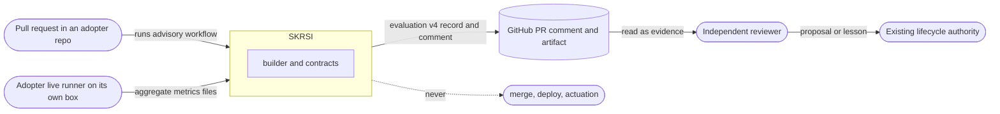
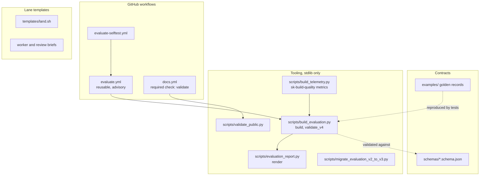
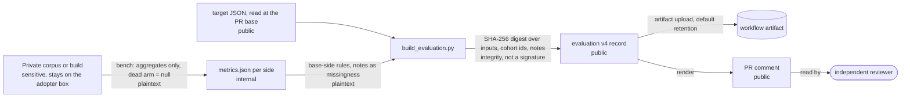
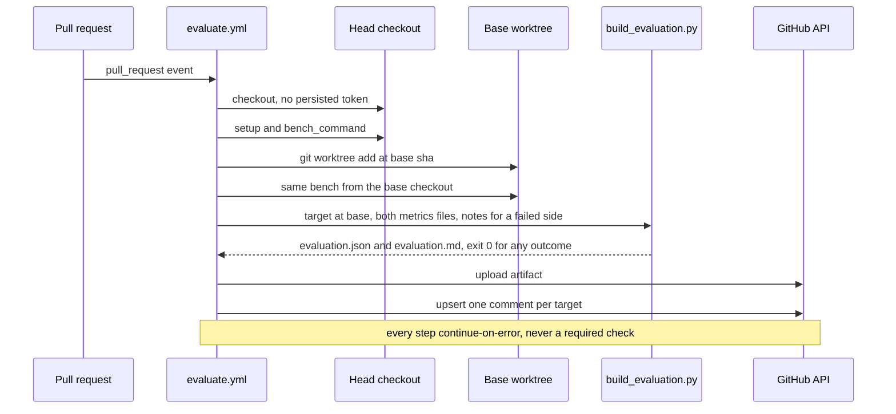

# SKRSI architecture

## Start here

**What this is.** SKRSI publishes the contracts and the advisory tooling for evidence-first improvement: a target says
what better means, a bench measures it, and `scripts/build_evaluation.py` turns two measurements into a validated
`skrsi.evaluation.v4` record. It proposes. It never authorizes, merges or deploys.

**Key entry points.**

| File | What happens there |
|---|---|
| `scripts/build_evaluation.py` | `build()` compares baseline and treatment under base-side rules; `validate_v4()` is the normative validator. |
| `scripts/evaluation_report.py` | `render()` writes the PR comment: what moved first, repeated missingness folded. |
| `.github/workflows/evaluate.yml` | The reusable, advisory PR workflow: bench both sides, build, upload, comment. |
| `schemas/evaluation-v4.schema.json` | The record contract, alongside `target-v2`, `event-envelope-v1` and `feedback-handoff-v1`. |
| `docs/ADOPTER-GUIDE.md` | How an adopter writes a target, a bench and a caller workflow. |

**The data it owns.** None at runtime. The repository holds schemas, synthetic examples and the targets of its own
tooling (`targets/sk-build-quality.json`). Evaluation records live with each adopter: PR comments, workflow artifacts,
and committed records such as skmemory's `skrsi/evaluations/`.

**External dependencies.** Python 3 standard library only for the scripts, `jsonschema` for tests, `gh` and GitHub
Actions for the workflow. Callers: adopter repositories (skmemory today, skstacks planned). The SKCapstone runtime
modules are a separate, older implementation (see Current implementation).

**Maturity tier.** T0: no key material. Version phase: Incubating v4.

## 1. System context

## 2. Component view

## 3. Data flow

Every hop carries metadata only. Nothing here is encrypted, because nothing here is secret: the protection that
matters is integrity and the data boundary.

> Classification: **sensitive** never leaves the adopter box; **internal** is aggregate metrics; **public** is what a
> repository or PR shows. Posture: plaintext metadata throughout. `evidence_sha256` detects a changed input. It does not
> prove who produced the record.

## 4. Sequence: one advisory PR evaluation

Live evidence takes a shorter path: the adopter runs its bench where the data is, flattens to aggregates, and calls
`build_evaluation.py` locally (see `docs/ADOPTER-GUIDE.md`, Live evidence).

## Identity

SKRSI is **SK Recursive SELF Improvement**. SELF expands to **Systematic Evaluation, Learning, and Feedback**.

## Responsibility boundary

| Component | Owns | Does not own |
|---|---|---|
| Target registry | Versioned targets, invariants, metrics, expiry, rollback proposal | Runtime activation |
| Collector | Bounded metadata ingestion, deduplication, lineage, missingness | Protected payload access |
| Evaluator | Deterministic cohort comparison and quality gates | Approval or causal claims without evidence |
| Experiment controller | Bounded proposal state and stop rules | Deployment or service mutation |
| Estate adapters | Typed software lifecycle handoffs | Product-domain policy |
| Dashboard projection | Authorized aggregate visibility | Source content or authorization decisions |
| Independent reviewer | Exact-evidence PASS, FAIL, or BLOCKED verdict | Producing the candidate it reviews |

## Invariants

1. Models and agents produce proposals. Existing policy owners authorize actions.
2. Producer and reviewer identities differ.
3. Missing data remains explicit and never becomes zero.
4. Throughput cannot override security, quality, independence, or rollback gates.
5. Every retry revalidates current authority and keeps the same idempotency boundary.
6. Historical evidence is append-only and is not rewritten for terminology changes.
7. SKRSI never selects what a final gate runs. A learned suggestion may trim a cheap tier only when a full gate still
   runs behind it.

## Current implementation

The first-wave implementation currently lives in SKCapstone modules named `skrsi_registry`, `skrsi_collector`, `skrsi_evaluator`, `skrsi_experiment_controller`, `skrsi_estate_adapters`, `skrsi_handoffs`, and `skrsi_runtime`. SKDashboard provides bounded aggregate visibility. Extraction into this repository is a future governed change, not implied by this documentation initialization. Those modules use `skrsi.target.v1` and `skrsi.cohort-evaluation.v1`, not the public `target-v2` and
`evaluation-v4` contracts, and no adopter currently feeds them; the public builder and workflow in this repository are
what adopters use.

## Public contract boundary

This repository owns portable, versioned data contracts for targets, event
envelopes, evaluations, and feedback handoffs. It does not provide a scheduler,
authorization service, model router, deployment controller, or product data
plane. Adopters validate records before persistence or transport, reject
unknown schema versions, preserve source bytes and hashes, and keep producer
and reviewer identities independent.
