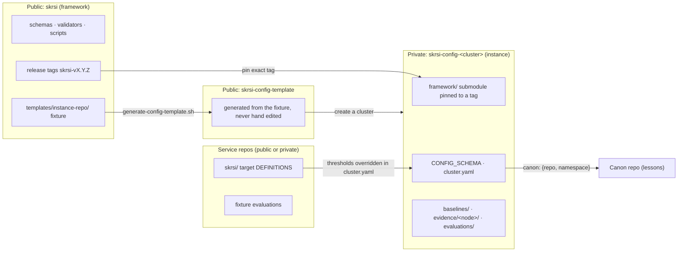

# SKRSI: the framework and instance model

SKRSI is split the same way as skstacks and skgateway. The **framework** (this repo, public) holds the code and the
contracts that know *how* to measure. An **instance** (one private `skrsi-config-<cluster>` repo per whole cluster)
holds only that cluster's facts: its nodes, its baselines, its evidence and its evaluations. The instance pins an
exact framework release as a git submodule. Framework code never lives in an instance, and cluster data never lives
in the framework.



## The split

| Lives in | What | Never |
|---|---|---|
| Service repo | `skrsi/` with target DEFINITIONS (target v2 stop rules are relative to a baseline, so they hold no cluster numbers) and fixture-based evaluations | live cluster baselines, live evaluations, absolute thresholds |
| Framework (`skrsi`) | schemas, validators, baseline and collector-side scripts, the instance fixture `templates/instance-repo/`, its generator, drift and scrub CI, these docs | cluster data, hostnames, measured numbers |
| Template (`skrsi-config-template`) | the output of `scripts/generate-config-template.sh`, nothing else | hand edits, real names |
| Instance (`skrsi-config-<cluster>`) | `CONFIG_SCHEMA`, `framework/`, `cluster.yaml`, `baselines/`, `evidence/<node>/<YYYY-MM-DD>.json` aggregates, `evaluations/` including `evaluations/recurrence/` and the 30 day review | framework code, addresses, domains, content, credentials |
| Canon (skbrain-ops or a cluster canon) | lessons, as canon pages of type `lesson` | recurrence counts (those are in the instance) |

The golden rule, as in skstacks: if another operator running a different cluster would want the change, it goes to
the framework. If it names a node, a number measured on a cluster, or a threshold for one cluster, it goes to the
instance. When both are true the change is split: the mechanism to the framework, the values to the instance.

There is one instance per whole cluster, never one per node or per service.

## Instance layout

```
skrsi-config-example/
├── framework/                     # git submodule, smilinTux/skrsi at a release tag (read-only)
├── CONFIG_SCHEMA                  # instance layout version, starts at 1
├── cluster.yaml                   # validated by schemas/cluster-v1.schema.json
├── baselines/                     # measured cluster baselines, aggregates only
├── evidence/
│   ├── node-a/2026-11-11.json     # one directory per declared node, one file per day
│   └── node-b/2026-11-11.json
├── evaluations/                   # skrsi.evaluation.v4 records, the 30 day review
│   └── recurrence/                # recurrence counts per lesson tag (JSON, created on first write)
├── .github/workflows/validate-instance.yml
└── README.md
```

### cluster.yaml

`cluster.yaml` follows `schemas/cluster-v1.schema.json` (`skrsi.cluster.v1`). Unknown fields fail.

| Field | Meaning |
|---|---|
| `schema` | `skrsi.cluster.v1` |
| `config_schema` | equals the `CONFIG_SCHEMA` file |
| `cluster` | cluster name; the repo is `skrsi-config-<cluster>` |
| `nodes[]` | `name` (short name: lowercase letters, digits, inner hyphens, no dots), `role`, `readers` (the collector readers enabled on that node; empty means enrolled but not collecting) |
| `services[]` | adopted services and the repos that hold their `skrsi/` target definitions |
| `canon` | `{repo, namespace}`: where this cluster's lessons live |
| `overrides[]` | optional `{target_id, metric, threshold, paused?}`: cluster thresholds for targets defined in service repos |

The node short names in `cluster.yaml` are the allowlist for the whole instance. The validator finds node names two
ways: as the value of a `node`, `nodes`, `host` or similar field, and as any host-shaped token (two or more letters
followed by two or more digits, such as `buildbox17`) in any key, any string value or the text of any other file.
Text is split on every character other than letters and digits, on camelCase and on digit-to-letter boundaries, and
lowercased, so `x_buildbox17_p95`, `BUILDBOX17`, `buildbox17x` and `2buildbox17` are all found. A hyphen-joined run
that equals a declared node (`gpu-box12`) is allowed. A name found either way that is not declared here fails
validation. Exempt: percentiles (`p95`), RFC numbers, Python and wheel tags (`py312`, `cp312`), `ubuntu2404`,
`node20`, `top10`, `ndcg10`, `es2022`, architecture names (`amd64`, `arm64`), `sha256`, hex digests and card ids,
and UUIDs. A host name with no trailing digits is not host-shaped; such names are caught by the denylist secret in
framework CI, not by instance validation.

### CONFIG_SCHEMA

`CONFIG_SCHEMA` holds one integer, the instance layout version. It starts at 1. The framework release states which
version it supports (`CONFIG_SCHEMA` in `scripts/cluster_config.py`). A change to the instance layout or
to `cluster.yaml` is a new `CONFIG_SCHEMA` and a new cluster schema file, called out in the CHANGELOG with a
migration note. An instance moves to it by bumping the submodule and its own files in one commit.

## The submodule pin

An instance pins `framework/` to a release tag `skrsi-vX.Y.Z`, never a branch:

```bash
git submodule add https://github.com/smilinTux/skrsi.git framework
git -C framework checkout skrsi-v1.0.0
git -C framework remote set-url --push origin DISABLED   # read-only by design
git add framework .gitmodules && git commit -m "pin framework skrsi-v1.0.0"
```

Instance CI validates every file against the schemas of the pinned framework. An instance never forks framework
code. A schema change is a submodule bump. If the framework needs a change, it is made upstream, released, and then
pinned.

## Lessons stay in canon

The instance does not hold lessons. `cluster.yaml` `canon: {repo, namespace}` points at the canon that does. Several
clusters may share one canon. If one cluster's readers must not see another's canon, that cluster gets its own canon,
and that is a change to `canon:` only. Recurrence counts are evidence, so they live in the instance under
`evaluations/recurrence/`, never in canon.

## Publishing evidence, out of band

- The collector writes to a node-local state dir, as it always has. Nothing about a request, a card claim, a
  dispatch, a completion, a memory search or a session start changes.
- A separate publish step, on the collect timer, copies the day's aggregates into that node's own
  `evidence/<node>/` path in a local instance checkout, runs `validate_instance.py`, commits, pulls with rebase and
  pushes. Node paths are disjoint, so nodes never conflict.
- Retries are bounded. A failure is recorded as missingness, never a block, and never retried inside a workflow.
- Each node pushes with a write deploy key scoped to that one instance repo. The key never goes in any repo, the
  framework, the template or the instance.
- A cross-cluster roll-up is a later, separate reader.

## What an instance may contain (SPEC rule 7, as amended)

Inside a private instance repo:

**Allowed:**

- node short names and roles declared in `cluster.yaml`;
- service and repo names;
- aggregate counts, rates and durations.

**Not allowed:**

- IP addresses (IPv4 or IPv6);
- domains or FQDNs;
- user or home paths;
- prompts, responses or memory content;
- card or PR text;
- credentials (tokens, passwords, keys, DSNs).

Enforcement is `scripts/validate_instance.py`. Instance CI runs it on every push and pull request, and the publish
step runs it before every push. It:

- validates `cluster.yaml` against the cluster schema and checks `CONFIG_SCHEMA`;
- walks every file except the top-level `framework/` submodule and the root `.git`; a nested `framework/` or
  `.git` directory is walked like any other;
- allows only `.json` and `.yaml` records under `baselines/`, `evidence/` and `evaluations/`, `README.md` only at
  the root and directly in those three, `.github/workflows/*.yml` (or `.yaml`), and at the root only
  `CONFIG_SCHEMA`, `cluster.yaml`, `.gitignore`, `.gitmodules` and `README.md`; rejects any symlink;
- uses the `cluster.yaml` node names as the allowlist, as described above;
- rejects any file under `evidence/` that is not `evidence/<declared node>/<YYYY-MM-DD>.json`, and an evidence
  `node` field that disagrees with its path;
- rejects IPv4 addresses (any dotted quad, leading zeros included), IPv6 addresses, domains, and home or user paths
  (including `/srv/<x>/<y>`), both in the raw text and in every decoded key and string value, so a JSON escape
  cannot hide one;
- rejects credential-shaped values anywhere: provider key prefixes (OpenAI style, GitHub, Slack, AWS key ids), PEM
  headers, and URLs that carry a user name and password;
- rejects content-like fields at any depth: a key whose tokens (split on `_`, `-` and camelCase) include `prompt`,
  `response`, `transcript`, `message`, `memory`, `query`, `question`, `answer`, `input`, `output`, `notes`,
  `summary`, `snippet`, `excerpt`, `stderr`, `stdout`, `log`, `payload`, `sample`, `body`, `title`, `description`,
  `content`, `text`, `header`, `auth`, `secret`, `password`, `pwd`, `token`, `dsn` or the rest of `CONTENT_TOKENS`,
  or card or PR plus `name`, `text`, `title` or `body`, or `api`, `private` or `access` plus `key`, AND whose value
  holds a string. A number cannot carry content, so `input_tokens: 10`, `token_budget: 1000` and `message_id: 5`
  pass;
- validates any record that names a `skrsi.*` schema with the pinned framework's normative validator, and rejects
  a schema an instance does not accept (today `skrsi.evaluation.v4` and `skrsi.cluster.v1`; lessons belong in
  canon);
- rejects files that are not UTF-8 text.

The validator is stdlib only, like every
script here, so instance CI and the publish step install nothing. `cluster.yaml` is read by `scripts/cluster_config.py`,
a strict YAML subset loader (block mappings and sequences, flow lists and maps, plain or quoted scalars, comments) that
rejects anchors, tags, multi-line strings, tabs, quotes inside flow collections, unmatched quotes, `a: b: c` and
numbers with a leading zero instead of guessing, and whose `cluster_errors` mirrors the schema
(tests hold both to PyYAML and to the JSON Schema). Each violation is printed on its own line
as `<path>: <problem>`, and the exit code is 1. The function `instance_errors(root)` is the same check for callers
that import it.

Domains are recognised by a closed list of public and private-network TLDs, so dotted metric names and event types
are not mistaken for them. A real domain on a TLD outside that list is not caught here; the private
`SKRSI_ESTATE_DENYLIST` secret in framework CI is the backstop for real estate names and domains.

The framework and the template stay scrubbed of real names, as in skstacks.

## Framework CI

`.github/workflows/instance-template.yml` is advisory, like the other workflows here:

- **drift:** clones the public `skrsi-config-template` repo, runs `scripts/generate-config-template.sh` into a temp
  dir and diffs the two (ignoring `.git`). That repo does not exist yet, so the job is a no-op until it is created: it
  prints a notice and passes. The generator itself is covered by unit tests (verbatim copy, stale files removed, and
  refusal of `/`, `$HOME`, the framework repo and any non-empty directory without a `CONFIG_SCHEMA` at its root,
an unrelated git checkout included).
- **scrub:** `validate_public.py`, then `validate_instance.py --scrub` over the framework (non-documentation IP
  addresses, home paths) and `--scrub --hostnames` over the template (also domains and host-shaped names), then the
  template is validated as an instance with `--cluster cluster.yaml.example`. Real estate names are checked through
  the private `SKRSI_ESTATE_DENYLIST` secret, so no public file has to spell them out. On a fork the secret is empty
  and only the public half runs.

## Create a cluster instance

1. Create an empty private repo `skrsi-config-<cluster>` (the repo owner does this, not an agent).
2. Generate the contents: `framework-checkout/scripts/generate-config-template.sh <new-repo-dir>`, or copy the public
   template repo.
3. Pin the framework as above, then delete `.gitmodules.example`.
4. `mv cluster.yaml.example cluster.yaml`, set `cluster`, declare every node with its role and readers, set `canon`.
5. Run `python framework/scripts/validate_instance.py .` until it passes, then commit and push.
6. Per node, add a write deploy key scoped to this repo, kept outside every repo, before enabling the publish step.
